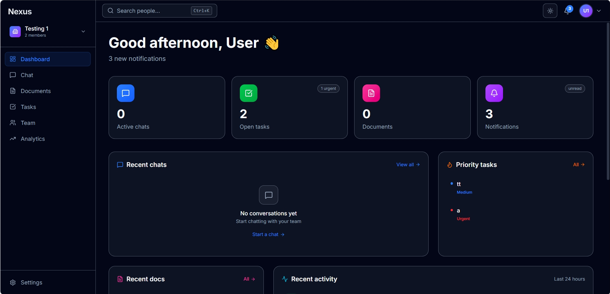
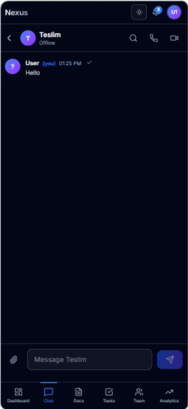

<div align="center">

# ⚡ Nexus

**Your team's all-in-one workspace.**

Chat · Video Calls · Documents · Tasks · Analytics · Calendar

[](https://nextjs.org)
[](https://www.typescriptlang.org)
[](https://tailwindcss.com)
[](https://www.prisma.io)
[](https://nexus-iota-two-17.vercel.app)

**[Explore the Live App](https://nexus-iota-two-17.vercel.app)** · **[Report a Bug](https://github.com/Alajagusi12/nexus/issues)** · **[View EvalOps (AI QA)](https://evalops-eight.vercel.app)**

</div>

---

## 🚀 The Engineering Challenge

Most teams suffer from "SaaS fatigue" — juggling Slack, Zoom, Notion, and Jira in different tabs, with fragmented contexts. 

**Nexus solves this by consolidating the entire workflow into one unified, real-time platform.** 

Building Nexus wasn't just about connecting APIs. It required solving complex problems:
- **Multi-Tenant Architecture:** Isolating data across Workspaces with Role-Based Access Control (Owner, Admin, Member, Guest).
- **Real-Time State Management:** Using Supabase WebSockets to sync typing indicators, Kanban drag-and-drop, and message delivery without page reloads.
- **Optimistic UI:** Making chat messages and task updates feel instant, even before the database confirms the write.
- **Rich Text Engineering:** Integrating Tiptap for a Notion-style editor with custom slash commands and autosave.

---

## ✨ Core Features

### 💬 Real-time Messaging
Direct messages and group chats. Threads, reactions, and message editing. File sharing, search, and pinned messages. Live typing indicators and presence. **Voice notes** recorded directly in the browser.

### 📹 Video & Voice Calls
One-click WebRTC calls powered by LiveKit. No plugins required. Incoming call popups and TURN server configuration for NAT traversal.

### 📝 Collaborative Documents
A rich-text editor built on Tiptap. Features custom slash commands (`/`), focus mode, word count, and PDF/Markdown export.

### ✅ Advanced Kanban Boards
Drag-and-drop task management. Add subtasks, comments, and priority labels. **Create tasks directly from chat messages.** Real-time sync across all connected clients.

### 📅 Calendar & Analytics
A visual calendar mapping out your task deadlines. A real-time analytics dashboard using Recharts to track message velocity, task completion rates, and team leaderboards.

### 🏢 Multi-Workspace & RBAC
Switch between workspaces. Manage team members with strict permission tiers. Generate secure invite links.

### 🎨 Legendary UI/UX
- Deep **Emerald** brand identity with glassmorphism.
- Fully responsive (Mobile-first design with collapsible sidebars).
- Global Command Palette (`Cmd + K`).
- Framer Motion micro-interactions and page transitions.
- Perfect Light/Dark mode harmony.

---

## 📸 Screenshots

> *Click the images to view them in full size.*

| Dashboard & Analytics | Real-time Chat |
| :---: | :---: |
|  |  |

| Kanban Tasks | Collaborative Docs |
| :---: | :---: |
|  |  |

---

## 🛠️ Tech Stack & Architecture

| Layer | Technology & Implementation |
|-------|-----------|
| **Framework** | Next.js 16 (App Router, Turbopack, Server Actions) |
| **Language** | TypeScript 5.9 (Strict mode) |
| **Database** | PostgreSQL (Neon.tech) |
| **ORM** | Prisma 6 (Complex relational mapping, JSON fields for subtasks) |
| **Auth** | NextAuth v5 (Credentials, bcrypt password hashing) |
| **Realtime** | Supabase Realtime (WebSockets for chat, typing, presence) |
| **UI/UX** | Tailwind CSS v4, Framer Motion, Radix UI primitives |
| **Video** | WebRTC + LiveKit |
| **Editor** | Tiptap (Headless Rich Text) |
| **Charts** | Recharts |
| **State** | React Hooks + SWR-like fetching |

---

## 🚦 Getting Started

### Prerequisites
- Node.js 20+
- PostgreSQL Database (Supabase or Neon recommended)
- LiveKit Account (for video calls)

### Installation

1. **Clone the repository**
   ```bash
   git clone https://github.com/Alajagusi12/nexus.git
   cd nexus
   npm install